  

# ⚡ Randhir Prem (`randhirprem`)
`Laboratory: Singapore 🇸🇬` | `Status: IT'S ALIVE. Checking the logs.`

> **Building platforms. Shipping containers. Teaching physical supply chains to obey my code.**

I'm a developer and infrastructure engineer with a perfectly reasonable ambition: wire the physical world into systems that actually work. Local labor networks, warehouses, mobile apps—everything is a potential experiment. Everything needs observability.

The host OS is a disposable hypervisor. Docker provides the containment chambers. I supply the questionable hypotheses and enough persistence to get them into production.

### 🧪 Experiments Currently Drawing Power

- `[██████████]` 🏙️ **9enjin — The Neighborhood Organism:** Architecting a multi-sided ecosystem that connects local labor, physical supply chains, and neighborhood hybrid nodes. Give a neighborhood a nervous system. See what it can do.
- `[████████░░]` 📦 **Foremost WMS — The Warehouse Oracle:** Scaling warehouse management with predictive analytics, EOQ models, and barcode integrations. The hypothesis: stockouts should be predictable, and “where did that pallet go?” should have an answer.
- `[██████████]` 🐧 **The Homelab — Containment Facility:** A Fedora-based server stack running containerized services under SELinux, Firewalld, and cgroups v2. Every creature gets a cage. Every cage gets resource limits.
- `[████████░░]` 📱 **Mobile Apps — Pocket-Sized Experiments:** Shipping cross-platform utilities with Flutter, Firebase, and Gemini AI. Because apparently the laboratory needs to fit in your pocket now.

### 🛠️ Laboratory Equipment

**Containment, Power & Life Support:**

    

**Instruments for Giving Ideas Legs:**

   

### 📡 Establish Contact

Have an interesting systems problem, an improbable idea, or logs making noises they shouldn't?

- **Reddit:** [u/papa_thambi](https://www.reddit.com/user/papa_thambi)
<!-- Add an email contact here when ready to make it public. -->

---

  <samp>The experiment is a success when someone else can run it without summoning me.</samp>

